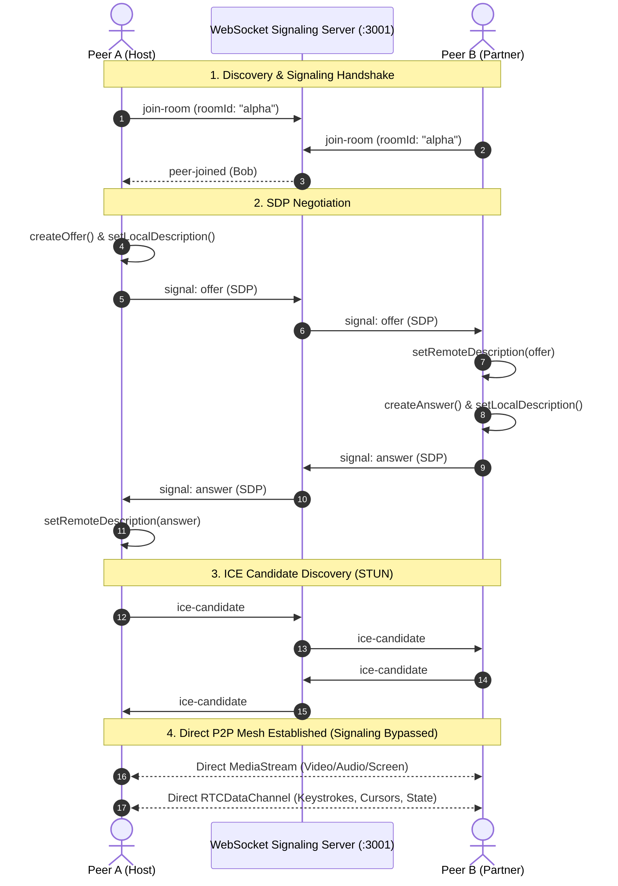

# ⚡ PairCraft: Low-Latency WebRTC Collaborative IDE

> **Real-Time Peer-to-Peer Pair Programming Platform** featuring direct bi-directional audio/video streaming, desktop screen sharing, synchronized Monaco code editing over WebRTC DataChannels, and in-browser sandboxed execution.


---

## 🌟 Key Highlights

- **Direct P2P Audio & Video:** Zero-relay media streaming directly between peers using `RTCPeerConnection` with sub-50ms latency.
- **Native Screen Sharing:** Seamlessly switch between local webcam and display media (`getDisplayMedia`) without interrupting active calls.
- **Sub-20ms Code & Cursor Synchronization:** Real-time character-by-character editing powered by Monaco Editor (`@monaco-editor/react`) and synchronized over WebRTC `RTCDataChannel` (with automatic WebSocket fallback).
- **In-Browser Sandboxed Code Execution:** Execute TypeScript, JavaScript, and other snippets directly in a secure, captured in-browser runner with terminal feedback.
- **Microservice WebSocket Signaling Server:** Lightweight, high-throughput signaling gateway for SDP offer/answer exchanges and STUN-assisted ICE candidate routing.
- **Zero Configuration:** 1-click instant room creation and shareable invite links with auto-reconnection and connection health telemetry.

---

## 🏗️ Architecture & Protocols



---

## 🚀 Quickstart & Local Development

### 1. Prerequisites
- **Node.js**: v18.0.0 or higher
- **npm** or **pnpm**

### 2. Installation
```bash
git clone https://github.com/your-username/webrtc-pair-ide.git
cd webrtc-pair-ide
npm install
```

### 3. Run Development Environment
A single command concurrently starts both the Next.js development server and the WebSocket signaling server:

```bash
npm run dev
```

- **Web Application:** [http://localhost:3000](http://localhost:3000)
- **Signaling Server:** [ws://localhost:3001](ws://localhost:3001) (Health check: [http://localhost:3001/health](http://localhost:3001/health))

---

## 🧪 Testing Split-Screen Collaboration

1. Open **[http://localhost:3000](http://localhost:3000)** in Google Chrome.
2. Enter your name and click **"Create Instant Room"**.
3. Click the **"Copy Room Link"** button in the header.
4. Open an **Incognito Window** (`Ctrl + Shift + N`) or a secondary browser profile.
5. Snap both windows side-by-side (`Win + Left` and `Win + Right`).
6. Paste the URL into the Incognito window and join.
7. Experience instant WebRTC audio/video streaming, sub-20ms code sync, and remote cursor tracking.

---

## 📦 Tech Stack

| Layer | Technologies |
| :--- | :--- |
| **Frontend Framework** | Next.js 16 (App Router, Turbopack, React 19) |
| **Real-Time P2P** | WebRTC (`RTCPeerConnection`, `RTCDataChannel`, Google STUN) |
| **Signaling** | Node.js, `ws` (WebSockets), HTTP Healthchecks |
| **Editor** | Monaco Editor (`@monaco-editor/react`), Custom Decorator Markers |
| **Styling & UI** | Tailwind CSS v4, Lucide Icons, Canvas Confetti |

---

## 📄 License
MIT License. Built for seamless developer collaboration.
